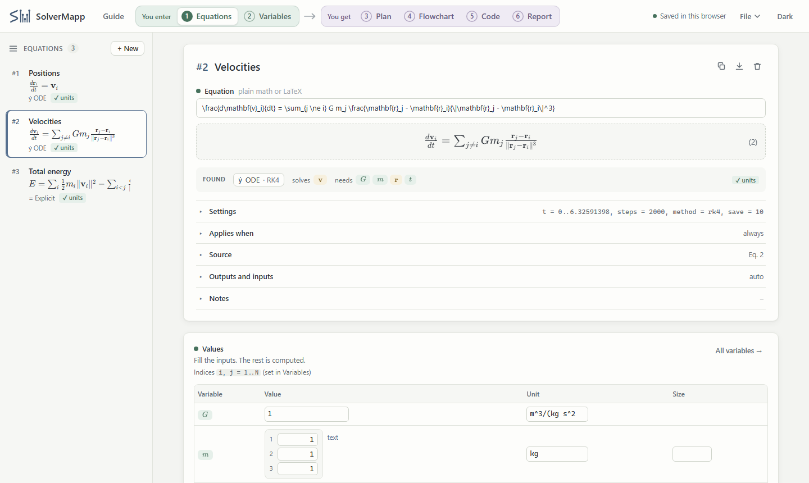
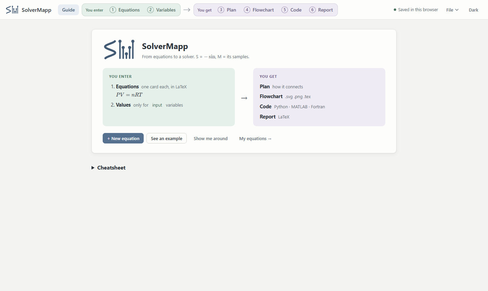
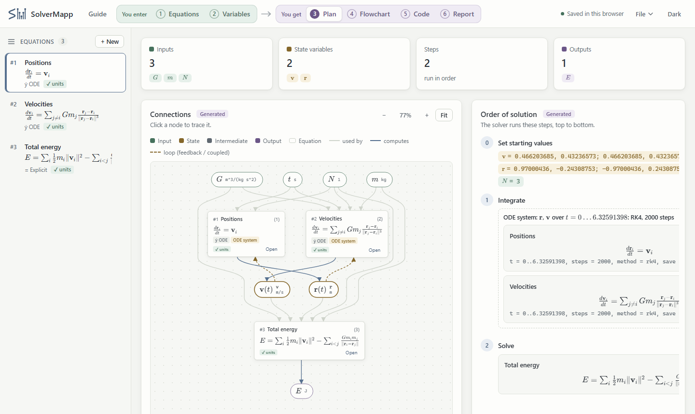
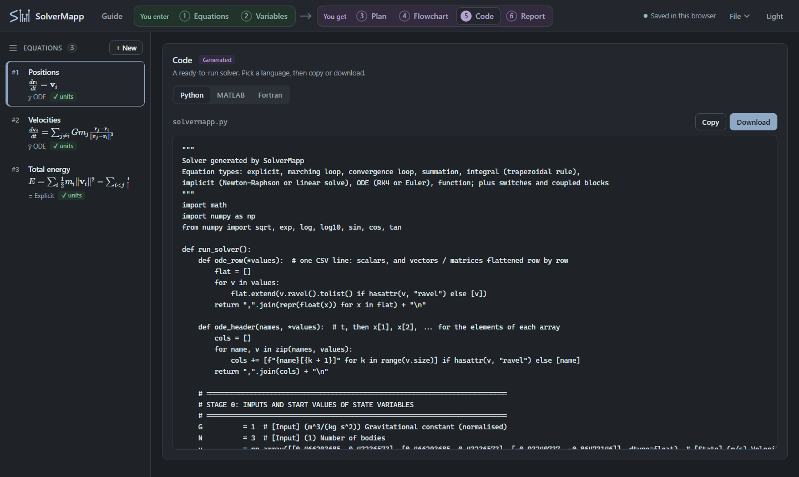

<p align="center">
  
</p>

<h1 align="center">SolverMapp</h1>

<p align="center">
  <b>From the equations of a paper to a working solver.</b><br>
  Type the equations of a model, give the inputs a value, and get the dependency map, the order of solution, a flowchart, a LaTeX report and a solver in Python, MATLAB or Fortran.
</p>

<p align="center">
  <a href="LICENSE"></a>
  
  
</p>



## Why

Numerical models in engineering and science are published as equations, often scattered across several papers. Turning them into a solver means working out which equation gives which unknown, in what order they must be solved, which ones form loops or must be solved together, and how each should be solved (directly, by iteration, by Newton-Raphson, by time integration). SolverMapp does that bookkeeping: you enter the equations as they appear in the papers, and it maps them into a solution procedure you can read, check, document and run.

The logo says the same thing: **-sin** drawn as a curve is the **S** (the continuous model), five samples of it are the **M** (the discrete solver).

## Quick start

1. Open **[the app](https://YOUR-GITHUB-USER.github.io/solvermapp/)**, or download this repository and open `index.html` in a browser. There is nothing to install or build.
2. **You enter:**
   - **Equations:** one card per equation, in plain math (`Re = rho*u*D/mu`) or LaTeX
     (`R_e = \frac{\rho u D}{\mu}`).
   - **Values:** a value and unit for each input. Everything else is computed.
3. **You get:**
   - **Plan:** the dependency graph and the order of solution.
   - **Flowchart:** as SVG, PNG, TikZ or Mermaid.
   - **Code:** a solver in Python, MATLAB or Fortran.
   - **Report:** a LaTeX model description with a BibTeX file.

New here? Click **See an example** on the Guide page: it opens the N-body problem (three bodies on the figure-eight orbit of Chenciner & Montgomery) in three equations, and a short tour shows where everything is.

| You enter | You get |
| --- | --- |
|  |  |

## What it understands

The type of each equation follows from how it is written, so there is no menu to set:

| You write | Type | Solved by |
| --- | --- | --- |
| `y = a x + b` | Explicit | direct assignment |
| `y_{n+1} = y_n + h f` | Marching loop | `N_steps` repetitions |
| `T_{new} = 0.5 T_{old} + c` | Convergence loop | iteration until the change is below `tol` |
| `S = \sum_{i=1}^{N} x_i` | Summation | a loop |
| `W = \int_{x_1}^{x_2} F \, dx` | Integral | trapezoidal rule |
| `P V = n R T` (unknown not alone on the left) | Implicit | Newton–Raphson, or a direct linear solve |
| `\frac{dT}{dt} = -k (T - T_\infty)` | ODE | RK4 or Euler; coupled ODEs as one system |
| `m \frac{d^2x}{dt^2} = F` or `m \ddot{x} = F` | Second-order ODE | rewritten as two first-order ODEs |
| `\mu(T) = \mu_0 e^{B/T}` | Function | a function in the code, used as `\mu` or `\mu(T)` |

It also handles:
- **Switches:** give equations for the same output a condition (*Applies when* `R_e < 2300`, `otherwise`).
- **Implicit equations:** a root plot shows every root, and `guess`, `min` and `max` keep Newton on the physical branch.
- **Vectors and matrices:** bold symbols, `\cdot`, `\times`, `\odot`, transpose, inverse, norm. Values are typed in a grid.
- **Index notation:** declare `i, j = 1..N`, then write `m_i`, `k_{ij}`, `\mathbf{r}_i`, `\sum_{j \ne i}` and `\sum_{i<j}`. An equation with a free index holds for every value of it, so the model does not grow with N.
- **Units:** every equation is checked for dimensional consistency (SI, with prefixes and `°C`).
- **Coupled equations:** equations that depend on each other in a cycle are grouped and solved together.

## Not supported yet

These are planned (see [ROADMAP.md](ROADMAP.md)), but version 1.0 does not solve them:

- **ODEs above second order** (`\frac{d^3x}{dt^3} = ...`). For now, write the equation as a chain: `\frac{dx}{dt} = w` and `\frac{d^2 w}{dt^2} = ...`.
- **Partial differential equations** (`\frac{\partial u}{\partial t}`, `\nabla^2`). The planned approach is the method of lines in 1-D.
- **Boundary value problems:** conditions at both ends, e.g. a beam. ODEs are solved as initial value problems.
- **Stiff ODEs:** steps are fixed, and there is no implicit method.

> **Important in 1.0:** equations of these kinds are not yet refused. They may be read as an ordinary equation, and the exported code is then wrong. If an equation contains `\partial`, `\nabla` or a third or higher derivative, do not use its output.

## The generated code

- **Python 3:** uses only `math`, plus NumPy when the model has vectors or matrices.
- **MATLAB:** a plain script.
- **Fortran:** free-form Fortran with `real(dp)` (double precision); compiles with `gfortran -Wall` without warnings on the example projects.



The code is meant to be read: it follows the order of solution, names the variables after the **Code name** column, and writes ODE trajectories to CSV files when asked (`save = 10`).

Every release is checked with the [tests](tests/README.md):
- **Same results everywhere:** the exported solvers give the same values as the browser in Python, MATLAB and gfortran, for every variable.
- **Same trajectories:** the CSV files are identical in all three languages.
- **Exact references:**
  - Newton cooling against its exact solution.
  - Rotation against cos and sin.
  - A Hilbert-matrix system and its products against NumPy.
  - A species network against the matrix exponential.
  - The indexed N-body model against the written-out three-body model (difference 2E-16).

## Your data

Everything runs in your browser: projects are kept in its local storage and saved to a file only
when you choose **File -> Export project**. Nothing is sent to a server. The only network request loads
[KaTeX](https://katex.org) (math display) from a CDN; without it, equations are shown as LaTeX source
and everything else keeps working.

## Project layout

```
index.html          the page (markup only)
css/solvermapp.css  styles, light and dark
js/                 the application, as plain scripts loaded in order (no build step)
examples/           example projects (File -> Import file...)
tests/              browser, snapshot and export tests
docs/               architecture, design notes, user guide, images
```

See [docs/ARCHITECTURE.md](docs/ARCHITECTURE.md) for how the parts fit together and
[docs/DESIGN_NOTES.md](docs/DESIGN_NOTES.md) for the reasoning behind the main decisions.

## Examples

Open them with **File → Import file…**:

| File | Shows |
| --- | --- |
| `n_body_index_notation.json` | N-body problem in index notation (the built-in demo) |
| `three_body_figure_eight.json` | the same, written out body by body; trajectory as CSV |
| `pipe_flow_switch.json` | μ(T), a laminar / turbulent switch, Colebrook by Newton |
| `cooling_and_oscillator_odes.json` | ODE systems with algebraic equations and forcing |
| `vectors_and_matrices.json` | linear system, products, vector ODE, vector root |
| `matrices_index_notation.json` | Hilbert matrix, row sums, solve, products, trace |
| `species_network_index_notation.json` | reaction network `dc_i/dt = \sum_j K_{ij} c_j` |
| `equation_types_tour.json` | one equation of each loop type, and van der Waals |

## Contributing

Bug reports, examples from your field and pull requests are welcome. Please read
[CONTRIBUTING.md](CONTRIBUTING.md) and our [Code of Conduct](CODE_OF_CONDUCT.md). Planned work is in
[ROADMAP.md](ROADMAP.md), and changes are listed in [CHANGELOG.md](CHANGELOG.md).

## Citing

If SolverMapp helps your research, please cite it. GitHub's **Cite this repository** button reads
[CITATION.cff](CITATION.cff).

## License

[MIT](LICENSE). KaTeX, loaded at run time, is also MIT licensed.
